# FFood — Web WordPress de un restaurante sin gluten (backend)

Sitio WordPress de **FFood**, un restaurante 100 % sin gluten, montado en Docker (WordPress + MariaDB + phpMyAdmin) y accesible en `http://lcornejo-restaurante.local:8083/`.

Este documento recoge la **configuración desde el panel de administración**. El resultado en la web (frontend) se muestra en el vídeo aparte.

> Las capturas están en la carpeta `img/`.

## Índice

0. [Configuración inicial](#0-configuración-inicial)
1. [Tema y personalización visual](#1-tema-y-personalización-visual)
2. [Portada](#2-portada)
3. [Usuarios y permisos](#3-usuarios-y-permisos)
4. [Organización del contenido](#4-organización-del-contenido)
5. [Tipo de contenido personalizado: Platos](#5-tipo-de-contenido-personalizado-platos)
6. [Menú principal](#6-menú-principal)
7. [Widgets](#7-widgets)
8. [Plugins](#8-plugins)
9. [Feed RSS](#9-feed-rss)
10. [Mapa de localización](#10-mapa-de-localización)
11. [CSS adicional y diseño responsive](#11-css-adicional-y-diseño-responsive)
12. [Actualización de PHP](#12-actualización-de-php)
13. [Copia de seguridad y restauración con UpdraftPlus](#13-copia-de-seguridad-y-restauración-con-updraftplus)

---

## 0. Configuración inicial

El sitio funciona con tres contenedores definidos en `docker-compose.yml`: WordPress, MariaDB y phpMyAdmin. Las variables (`PROYECTO_ID`, `DB_NAME`, `DB_USER`, `DB_PASSWORD`, `DB_ROOT_PASSWORD`) se leen del archivo `.env`.

```yaml
services:
  pr2_wordpress:
    image: wordpress:6.9.4-php8.5.12-apache
    container_name: wp${PROYECTO_ID}
    ports:
      - "8083:80"
    depends_on:
      - pr2_bd_wp
    environment:
      WORDPRESS_DB_HOST: pr2_bd_wp
      WORDPRESS_DB_USER: ${DB_USER}
      WORDPRESS_DB_PASSWORD: ${DB_PASSWORD}
      WORDPRESS_DB_NAME: ${DB_NAME}
      WORDPRESS_TABLE_PREFIX: "lcornejo_"
      WORDPRESS_CONFIG_EXTRA: |
        define('WP_HOME', 'http://lcornejo-restaurante.local:8083');
        define('WP_SITEURL', 'http://lcornejo-restaurante.local:8083');
    volumes:
      - wp_content:/var/www/html/wp-content  # Directorio de Wordpress
      - ./uploads.ini:/usr/local/etc/php/conf.d/uploads.ini
    restart: always
    networks:
      - wp_network

  pr2_bd_wp:
    image: mariadb:11.4
    container_name: db${PROYECTO_ID}
    environment:
      MYSQL_DATABASE: ${DB_NAME}
      MYSQL_USER: ${DB_USER}
      MYSQL_PASSWORD: ${DB_PASSWORD}
      MYSQL_ROOT_PASSWORD: ${DB_ROOT_PASSWORD}
    volumes:
      - bd_datos:/var/lib/mysql  # directorio de los archivos de la BD
    restart: always
    networks:
      - wp_network

  pr2_phpmyadmin:
    image: phpmyadmin:5.2-apache
    container_name: pma_${PROYECTO_ID}
    ports:
      - "8084:80"
    environment:
      PMA_HOST: pr2_bd_wp  # servicio de la BD
    depends_on:
      - pr2_bd_wp
    restart: always
    networks:
      - wp_network

volumes:
  bd_datos:
  wp_content:

networks:
  wp_network:
    driver: bridge
```

Puntos clave de la configuración:

| Elemento | Detalle |
|---|---|
| WordPress | Puerto `8083`, prefijo de tablas `lcornejo_` y URL fija `http://lcornejo-restaurante.local:8083` (`WP_HOME` / `WP_SITEURL`) |
| `uploads.ini` | Sube el límite de subida de PHP a 64 MB (ver [Smush](#smush-optimización-de-imágenes)) |
| MariaDB | Sin puertos publicados: solo es accesible desde la red interna `wp_network` |
| phpMyAdmin | Puerto `8084`, conectado al servicio `pr2_bd_wp` |
| Volúmenes | `wp_content` (temas, plugins y medios) y `bd_datos` (base de datos), para que los datos no se pierdan al recrear los contenedores |

Contenedores en ejecución (`sudo docker ps`):

```
CONTAINER ID   IMAGE                           COMMAND                  CREATED       STATUS              PORTS                                     NAMES
ec7b3acb9b29   wordpress:6.9.4-php8.5-apache   "docker-entrypoint.s…"   6 days ago    Up About an hour    0.0.0.0:8083->80/tcp, [::]:8083->80/tcp   wpLUIS_P3-1
c7194bba683e   phpmyadmin:5.2-apache           "/docker-entrypoint.…"   12 days ago   Up About an hour    0.0.0.0:8084->80/tcp, [::]:8084->80/tcp   pma_LUIS_P3-1
866b9ceb68b0   mariadb:11.4                    "docker-entrypoint.s…"   12 days ago   Up About an hour    3306/tcp                                  dbLUIS_P3-1
```

Volúmenes creados (`sudo docker volume ls`):

```
DRIVER    VOLUME NAME
local     p3-wp_bd_datos
local     p3-wp_wp_content
```

---

## 1. Tema y personalización visual

### Tema

Se mantiene **Astra**, un tema gratuito que aparece entre los propuestos en la práctica. El diseño se hizo desde **Apariencia → Personalizar** y con **CSS adicional**.

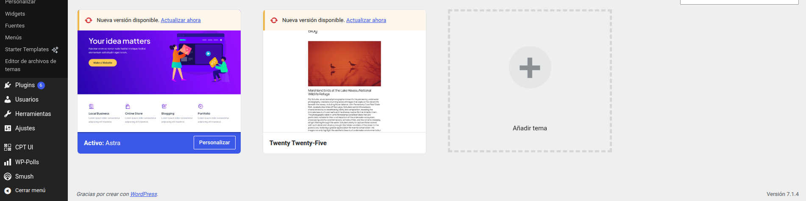

### Título, descripción, logo e icono

En **Personalizar → Identidad del sitio**:

| Campo | Valor |
|---|---|
| Título | FFood |
| Descripción | Restaurante 100% sin gluten · Cocina artesanal en cada plato |
| Logo | Espiga de trigo tachada (sin gluten) |
| Icono del sitio | El mismo logo, 512 × 512 px |

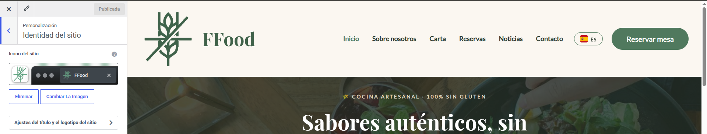

### Colores

En **Personalizar → Global → Colores** se definió una paleta **natural y cálida con colores planos**, sin degradados:

| Uso | Color |
|---|---|
| Color principal (botones, enlaces) | `#4F7A5E` verde salvia |
| Títulos / fondos oscuros | `#2B3A2F` verde oscuro |
| Texto | `#5A5A4E` |
| Fondo alternativo de secciones | `#F7F2E9` crema |
| Cabecera | `#FBF8F2` |
| Bordes | `#E5DCC8` beige |

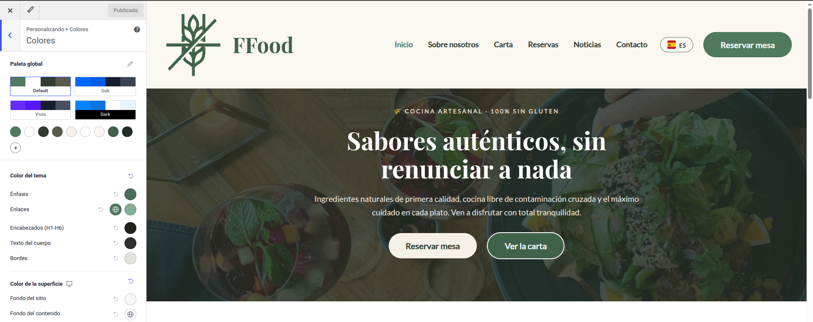

### Tipografía

En **Personalizar → Global → Tipografía**:

| Elemento | Fuente |
|---|---|
| Títulos | Playfair Display, 700 |
| Texto | Lato, 400 |

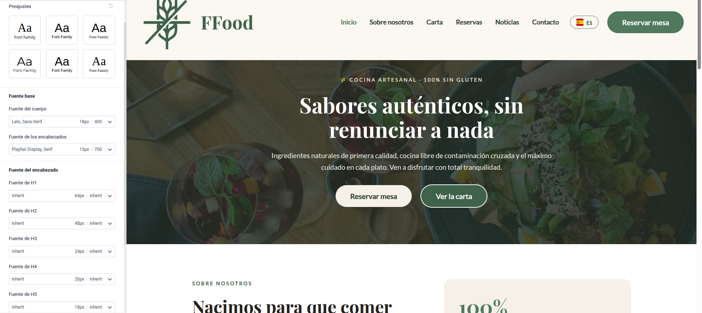

### Imagen de cabecera

La foto de cabecera es gratuita y se descargó de Pexels (autora: Anna Tukhfatullina). Se subió a la **biblioteca de medios** (`ffood-cabecera-optimizada.jpg`) recortada a 1200 × 675 px, para que pesara **177 KB**, por debajo del límite recomendado de 200 KB. Se usa de fondo en el bloque *Portada* de la página Inicio y como su imagen destacada.

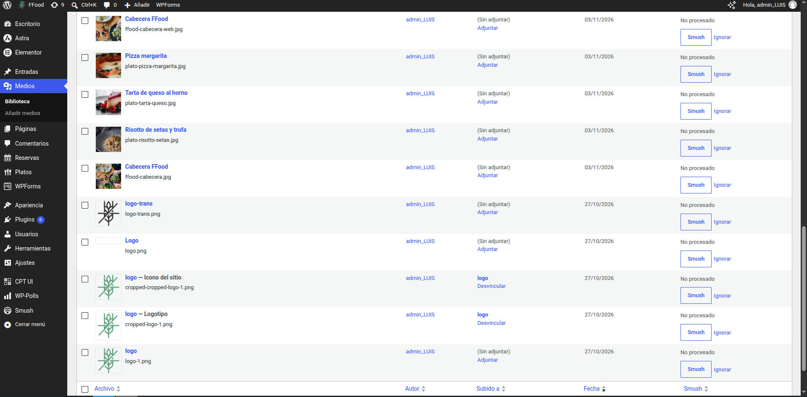

---

## 2. Portada

La página **Inicio** se editó con el editor de bloques. Se sustituyó todo el contenido de ejemplo de la plantilla de Astra por textos propios. Cada sección es un bloque *Grupo* con un anclaje HTML, que es lo que usa el menú:

| Sección | Anclaje |
|---|---|
| Portada (bloque *Portada* con foto, título y botones) | — |
| Sobre nosotros | `about` |
| Valoraciones | `reviews` |
| Por qué nosotros | `whyus` |
| Reserva tu mesa (shortcode `[booking-form]`) | `contact` |

En **Personalizar → Pie de página → Copyright** se puso: `© [current_year] FFood · Cocina 100% sin gluten · Todos los derechos reservados`.

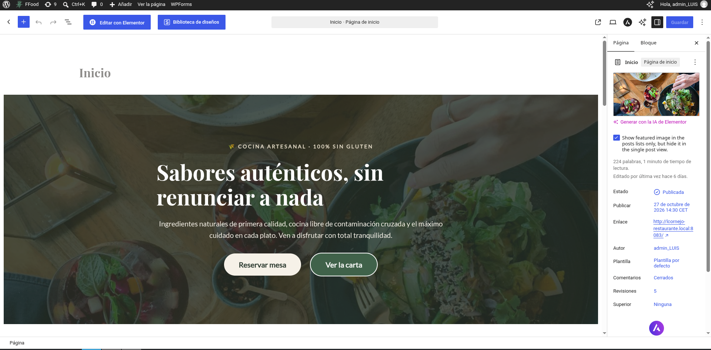

---

## 3. Usuarios y permisos

En **Usuarios** están creados los cuatro usuarios que pide la práctica:

| Usuario | Rol | Uso |
|---|---|---|
| `admin_LUIS` | Administrador | Gestión completa del sitio |
| `chef_LUIS` | Autor | Publica recetas |
| `recepcion_LUIS` | Colaborador | Gestiona reservas |
| `cliente_LUIS` | Suscriptor | Cliente registrado |

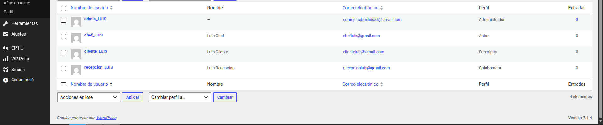

### Permisos de cada rol

| Rol | Puede | No puede |
|---|---|---|
| Administrador | Todo | — |
| Autor | Crear, editar y **publicar** sus entradas; subir medios | Editar entradas ajenas, páginas, apariencia, plugins, usuarios o ajustes |
| Colaborador | Crear y editar sus entradas | Publicar (solo **"Enviar a revisión"**), subir medios |
| Suscriptor | Ver el escritorio y su perfil | Crear o editar contenido |

> **Nota:** el rol Colaborador no gestiona reservas por defecto. En *Five Star Restaurant Reservations* esa tarea queda para Administradores y Editores.

---

## 4. Organización del contenido

### Categorías y etiquetas

- **Categorías:** Promociones, Eventos, Novedad (cada una con su descripción).
- **Etiquetas:** vino, menú, degustación, ofertas, singluten.

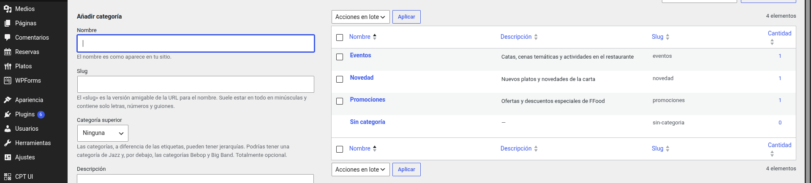
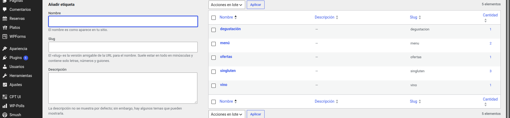

### Páginas

| Página | Contenido |
|---|---|
| Inicio | Página de inicio estática |
| Sobre nosotros | Hecha con Elementor |
| Carta | Platos por secciones con precio; encuesta al final |
| Reservas | Horario, normas y formulario de reservas |
| Noticias | Página de entradas |
| Contacto | Datos de contacto, mapa y formulario |
| Suscríbete | Explica cómo suscribirse al RSS |

En **Ajustes → Lectura**, Inicio es la portada estática y Noticias la página de entradas.

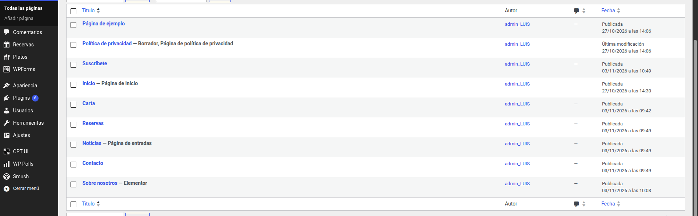
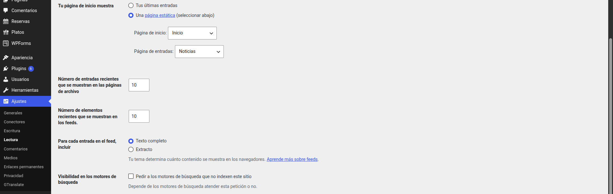

### Entradas (noticias)

| Entrada | Categoría | Etiquetas |
|---|---|---|
| Nuevo en la carta: risotto de setas y trufa | Novedad | singluten, menú |
| Promoción: menú del día sin gluten a 14,90 € | Promociones | ofertas, menú, singluten |
| Evento: cena maridaje con vinos valencianos | Eventos | vino, degustación, singluten |

Cada entrada tiene imagen destacada y extracto. La entrada de ejemplo "¡Hola, mundo!" se pasó a borrador.

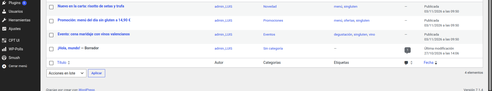

---

## 5. Tipo de contenido personalizado: Platos

Se instaló **Custom Post Type UI** y se creó el tipo de contenido `plato`:

| Opción | Valor |
|---|---|
| Slug | `plato` |
| Etiquetas | Platos / Plato |
| Icono | `dashicons-food` |
| Archivo | Sí (`/platos/`) |
| Soporta | Título, editor, imagen destacada, extracto, campos personalizados, revisiones |
| REST / Gutenberg | Sí |

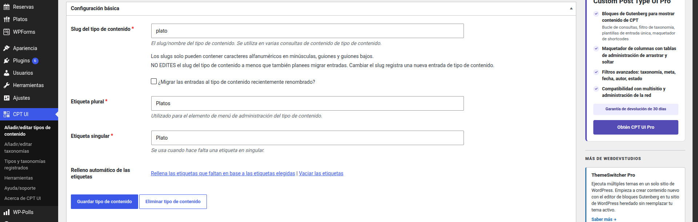

Se crearon tres platos. Cada uno tiene imagen destacada, descripción, ingredientes y una tabla con tipo, precio, si es sin gluten y otros alérgenos. Las imágenes son de Pexels, a 800 × 600 px:

| Plato | Imagen | Peso |
|---|---|---|
| Risotto de setas y trufa | `plato-risotto-setas.jpg` | 73 KB |
| Pizza margarita | `plato-pizza-margarita.jpg` | 54 KB |
| Tarta de queso al horno | `plato-tarta-queso.jpg` | 57 KB |

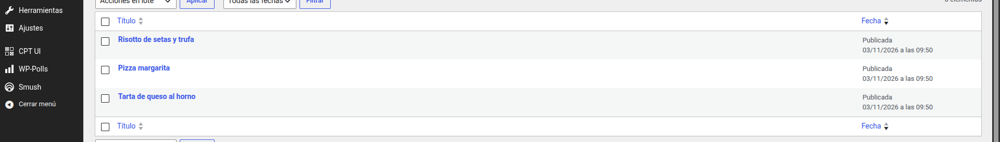
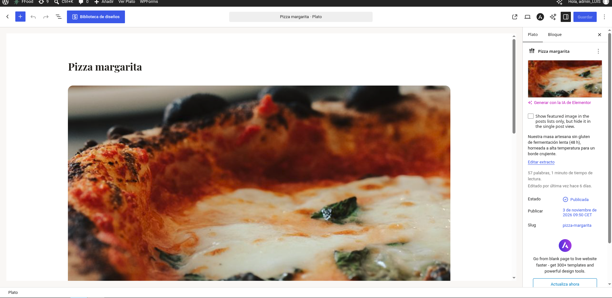

---

## 6. Menú principal

En **Apariencia → Menús** se creó **"Menú principal"** con: Inicio, Sobre nosotros, Carta, Reservas, Noticias y Contacto. Se asignó a dos ubicaciones:

- **Menú principal** (escritorio).
- **Menú fuera del lienzo** (el menú desplegable del móvil).

El botón **"Reservar mesa"** de la cabecera se configuró en **Personalizar → Cabecera → Botón** y enlaza a la página Reservas.

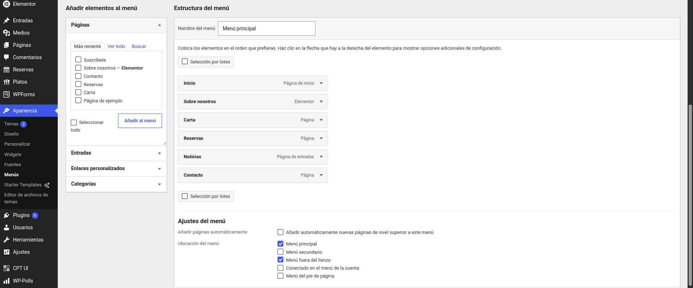

---

## 7. Widgets

En **Apariencia → Widgets**:

**Pie de página 1:**

- Párrafo **"Restaurante Gourmet Luis - 2025"**.
- Bloque *Iconos sociales* con el icono RSS ("Suscríbete a nuestro RSS").
- Shortcode `[gtranslate]` para el selector de idioma en móvil.
- Bloque *HTML personalizado* con el script que hace que el selector cambie de idioma con un clic.

**Barra lateral principal:**

- Buscador ("Buscar en FFood").
- Últimas noticias, con miniatura y fecha.
- Categorías.
- **Blogs de alimentación**: tres bloques *RSS* externos.

En **Personalizar → Barra lateral** se activó la barra lateral derecha solo para el archivo del blog y las entradas.

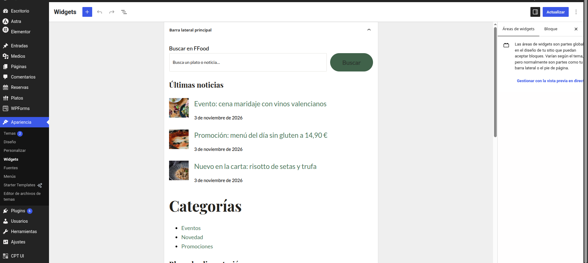

---

## 8. Plugins

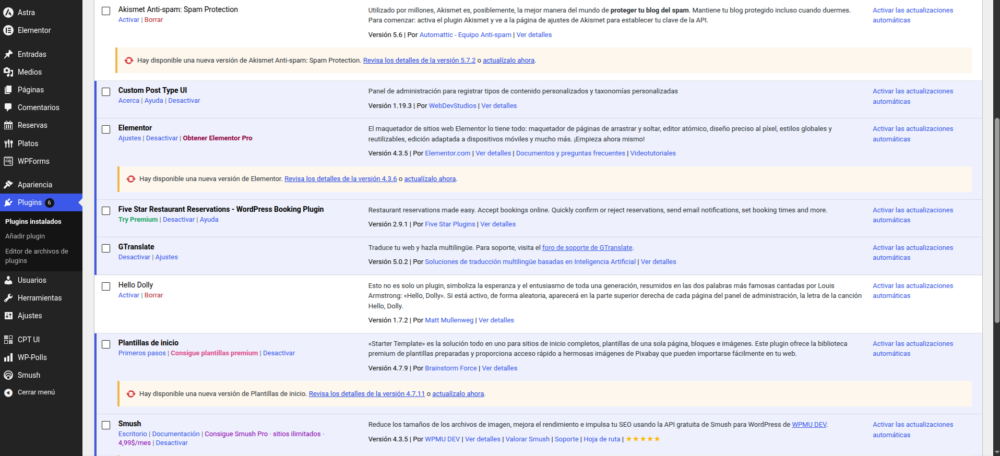
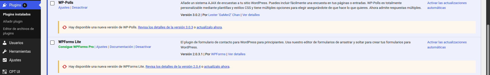

### Smush (optimización de imágenes)

- **Carga diferida** activada en todas las áreas.
- **Compresión automática** al subir imágenes.
- **Redimensionar imágenes grandes** a un máximo de 1920 × 1920 px.

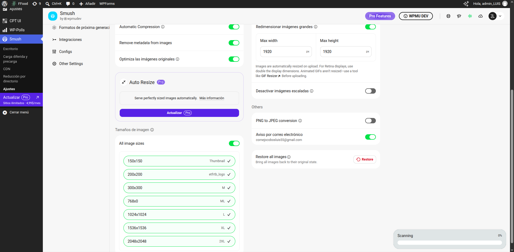
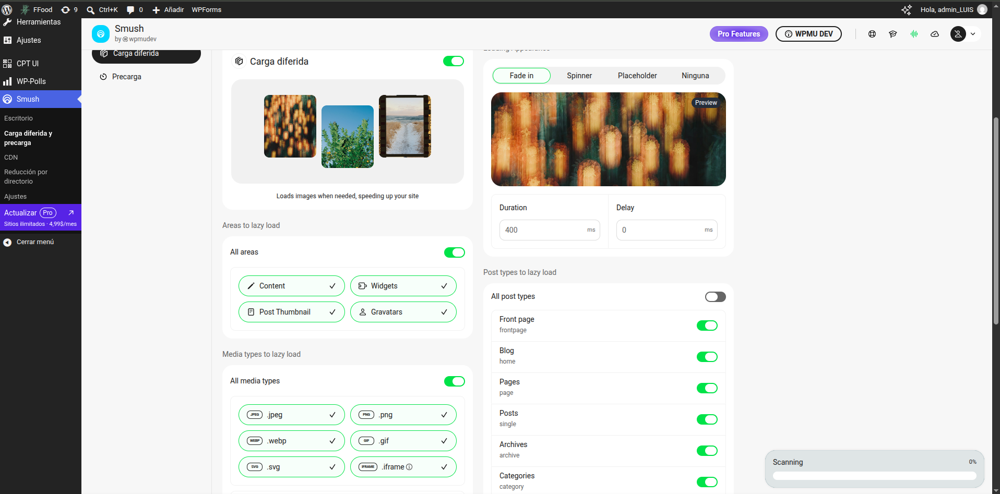

Para probarlo con imágenes de más de 2 MB primero hubo que subir el límite de PHP, que estaba en 2 MB. Se creó `uploads.ini` junto al `docker-compose.yml`:

```ini
file_uploads = On
upload_max_filesize = 64M
post_max_size = 64M
memory_limit = 256M
max_execution_time = 300
```

Se montó en el servicio de WordPress y se recreó el contenedor:

```yaml
    volumes:
      - ./uploads.ini:/usr/local/etc/php/conf.d/uploads.ini
```

```
$ sudo docker compose up -d
```

En **Medios → Añadir nuevo** pasó a aparecer *"Tamaño máximo de archivo: 64 MB"*.

Resultado de la prueba:

| Imagen | Subida | Imagen principal tras subir | Ahorro de Smush (9 tamaños) |
|---|---|---|---|
| Plato de pasta | 2,8 MB | 214 KB (1920 × 1280) | 97,9 KB (2,7 %) |
| Bol de comida saludable | 2,4 MB | 476 KB (1920 × 1440) | 172 KB (4,1 %) |

La mayor reducción viene del redimensionado a 1920 px. Además, la versión gratuita de Smush no procesa archivos de más de 5 MB.

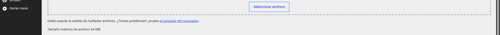
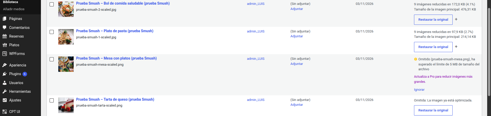

### GTranslate (multilingüe)

En **Ajustes → GTranslate**:

- **Idiomas:** español (por defecto) e inglés.
- **Mostrar en el menú:** menú principal.

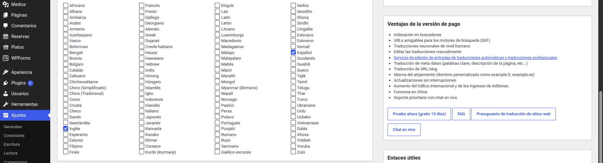

### WP-Polls (encuesta)

- **Encuesta:** "¿Cuál es tu plato favorito?".
- **Opciones:** Risotto de setas y trufa, Pizza margarita, Hamburguesa de ternera gallega, Lasaña boloñesa y Tarta de queso al horno.
- **Ubicación:** se insertó con el shortcode `[poll id="2"]` al final de la página **Carta**.

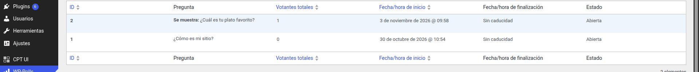

### WPForms (formulario de contacto)

- **Formulario:** "Contacto FFood".
- **Campos:** Nombre y apellidos (formato nombre/apellidos), Edad (número), Correo electrónico y Mensaje, todos obligatorios.
- **Ubicación:** se insertó con `[wpforms id="88" title="false"]` en la página **Contacto**.

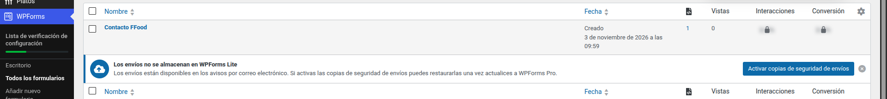

### Five Star Restaurant Reservations (reservas)

Configuración en **Reservas → Ajustes**:

| Opción | Valor |
|---|---|
| Comidas | Martes a domingo, 13:00–16:00 |
| Cenas | Martes a sábado, 20:00–23:00 |
| Lunes | Cerrado |
| Intervalo entre horas | 30 minutos |
| Máximo de comensales | 12 |
| Teléfono | Obligatorio |
| Página de reservas | Reservas |

El formulario se inserta con `[booking-form]` en la página **Reservas** (que está en el menú) y en la portada.

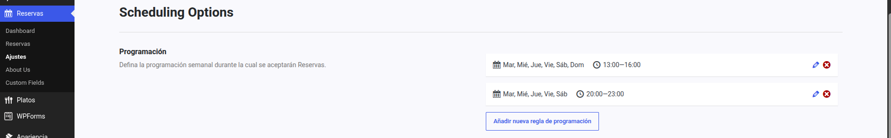
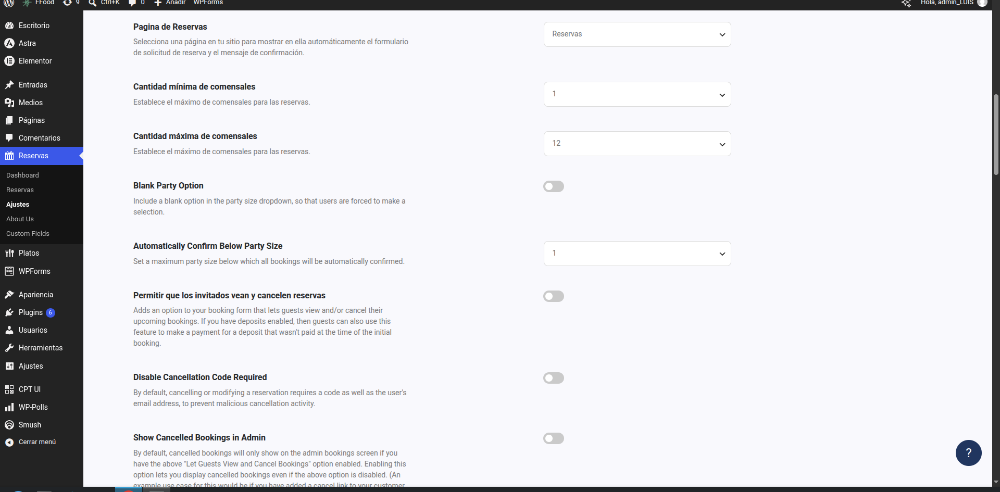

### Elementor (página "Sobre nosotros")

La página **Sobre nosotros** se maquetó con Elementor usando contenedores:

1. Cabecera verde oscuro con título.
2. Historia del restaurante: imagen y texto, con botón "Ver la carta".
3. Tres tarjetas de valores (widget *Icon Box*).
4. Contadores (widget *Counter*): año de apertura, platos en carta y % sin gluten.
5. Bloque final con el botón "Reservar mesa".

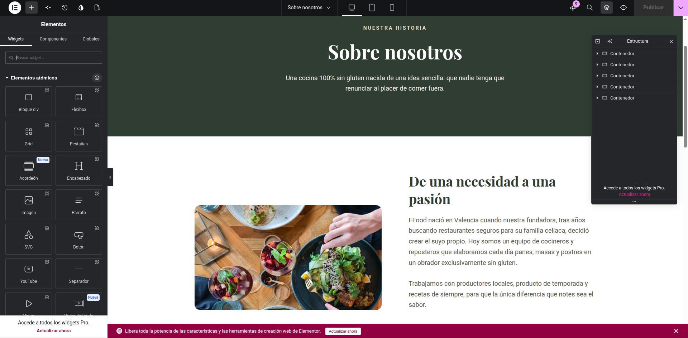

---

## 9. Feed RSS

### Feed del sitio

Al principio `/feed/` daba **404** porque los enlaces permanentes estaban en "Simple". Se cambiaron en **Ajustes → Enlaces permanentes** a **"Nombre de la entrada"** (`/%postname%/`). Desde entonces el feed funciona en:

```
http://lcornejo-restaurante.local:8083/feed/
```

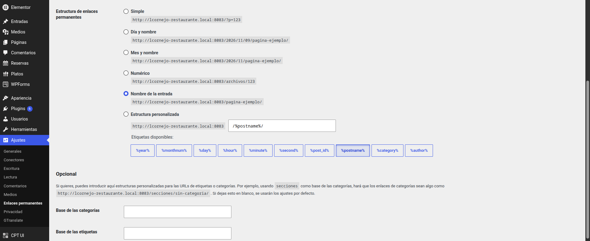

### Icono del feed en el pie

El icono RSS del pie (bloque *Iconos sociales*, servicio *Feed*) lleva a la página **Suscríbete**, porque el navegador muestra el XML del feed en bruto. Esa página:

- Explica cómo suscribirse.
- Muestra la dirección del feed con un botón **Copiar** (bloque *HTML personalizado*).
- Enlaza al XML.
- Muestra las tres últimas noticias (bloque *Últimas entradas*).

### Feeds externos en la barra lateral

Widget **"Blogs de alimentación"** con bloques *RSS* (2 publicaciones de cada uno):

| Blog | Feed |
|---|---|
| Velocidad Cuchara | `https://www.velocidadcuchara.com/feed/` |
| Directo al Paladar | `https://www.directoalpaladar.com/index.xml` |
| Asociación de Celíacos de Asturias | `https://www.celiacos.org/feed/` |

---

## 10. Mapa de localización

En la página **Contacto** se añadió la sección **"Cómo llegar"**. Tiene un bloque *HTML personalizado* con un `<iframe>` de Google Maps centrado en el **CIPFP Mislata** (Carrer de Dolores Ibárruri, 32, 46920 Mislata, Valencia):

```html
<iframe src="https://maps.google.com/maps?q=CIPFP%20Mislata&t=m&z=16&output=embed"
        width="100%" height="420" style="border:0;border-radius:16px"
        allowfullscreen loading="lazy"></iframe>
```

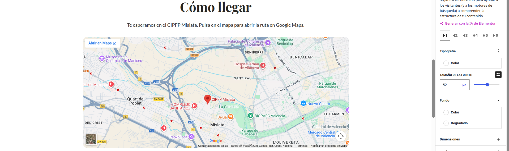

---

## 11. CSS adicional y diseño responsive

Los retoques visuales que no ofrece Astra se añadieron en **Personalizar → CSS adicional**, organizados por bloques comentados:

- **Componentes:** tarjetas con sombra, botones redondeados, formularios de reservas y contacto, carta (nombre del plato y precio en la misma línea).
- **Selector de idioma:** con forma de píldora y centrado en la cabecera.
- **Página Noticias:** rejilla que se adapta al número de entradas. Con un número impar, la primera sale destacada a todo el ancho; con 7 o más, se usan 3 columnas.
- **Responsive**, con `@media` a 921 px (tableta) y 767 px (móvil):
  - Títulos que se adaptan con `clamp()`.
  - Menos espacio vertical entre secciones.
  - Columnas que se apilan.
  - Botones y formularios a todo el ancho.
  - Botón del menú móvil visible.
  - Mapa más bajo.

La vista en móvil se comprobó con la vista previa de dispositivo del editor de bloques (icono de pantalla de la barra superior → Móvil) y del Personalizador.

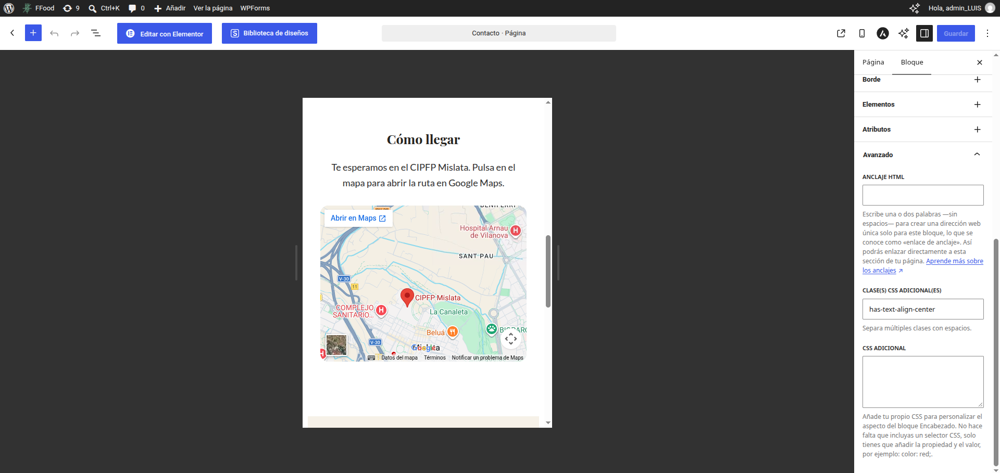

---

## 12. Actualización de PHP

> **Nota:** esta actualización se hizo sobre una **copia del proyecto** (`p3-wp-backup`), no sobre el sitio original, para probarla sin riesgo. Por eso los contenedores se llaman `...P3-1-backup` y el volumen `p3-wp-backup_wp_content`, en lugar de los nombres del [apartado 0](#0-configuración-inicial).

El contenedor de WordPress tenía PHP 8.5.6 y el objetivo era tener PHP 8.5.12 o superior. En Docker la versión de PHP viene dentro de la imagen, así que no se actualiza desde WordPress, sino cambiando la imagen del `docker-compose.yml`.

Primero se comprobó la versión que había:

```
$ sudo docker compose exec pr2_wordpress php -v
PHP 8.5.6 (cli) (built: May 19 2026 23:08:16) (NTS)
```

Con la imagen `wordpress:6.9-php8.5-apache`, aunque se hiciera `pull`, seguía saliendo la misma versión, porque esa imagen ya no se reconstruye con PHP nuevos. Para ver qué PHP lleva cada tag se probaron varios sin tocar el proyecto:

```
$ for t in 6.9-php8.5-apache 7.0-php8.5-apache 7.1-php8.5-apache php8.5-apache; do
    echo "== $t"; sudo docker run --rm wordpress:$t php -v | head -1
  done
== 6.9-php8.5-apache
PHP 8.5.6 (cli) (built: May 19 2026 23:08:16) (NTS)
== 7.0-php8.5-apache
PHP 8.5.9 (cli) (built: Aug  5 2026 00:26:29) (NTS)
== 7.1-php8.5-apache
PHP 8.5.12 (cli) (built: Nov  5 2026 07:20:51) (NTS)
== php8.5-apache
PHP 8.5.12 (cli) (built: Nov  5 2026 07:20:51) (NTS)
```

La primera versión con PHP 8.5.12 es WordPress 7.1, así que hay que subir de 6.9 a 7.1. Como eso actualiza también la base de datos, antes se hizo una copia de la base de datos y del volumen `wp_content`:

```
$ sudo docker compose exec pr2_bd_wp sh -c 'mariadb-dump -u root -p"$MYSQL_ROOT_PASSWORD" "$MYSQL_DATABASE"' > backup_antes_7.1.sql

$ sudo docker run --rm -v p3-wp-backup_wp_content:/data -v "$PWD":/out alpine tar czf /out/wp_content_antes_7.1.tgz -C /data .
```

Después se cambió la imagen en el `docker-compose.yml`:

```
$ grep image docker-compose.yml
    image: wordpress:7.1-php8.5-apache
    image: mariadb:11.4
    image: phpmyadmin:5.2-apache
```

Se descargó la imagen nueva y se recreó el contenedor de WordPress. La base de datos y phpMyAdmin no cambian, y los datos se conservan porque están en volúmenes:

```
$ sudo docker compose pull pr2_wordpress
 ✓ Image wordpress:7.1-php8.5-apache Pulled

$ sudo docker compose up -d
 ✓ Container dbLUIS_P3-1-backup   Running
 ✓ Container pma_LUIS_P3-1-backup Running
 ✓ Container wpLUIS_P3-1-backup   Started
```

Por último se comprobó que PHP se había actualizado:

```
$ sudo docker compose exec pr2_wordpress php -v
PHP 8.5.12 (cli) (built: Nov  5 2026 07:20:51) (NTS)
Copyright (c) The PHP Group
Built by https://github.com/docker-library/php
Zend Engine v4.5.12, Copyright (c) Zend Technologies
    with Zend OPcache v8.5.12, Copyright (c), by Zend Technologies
```

---

## 13. Copia de seguridad y restauración con UpdraftPlus

### 13.1 Instalación de UpdraftPlus

Se instaló desde **Plugins → Añadir plugin**, buscando "UpdraftPlus", y se activó. La versión instalada es la **1.26.14**.

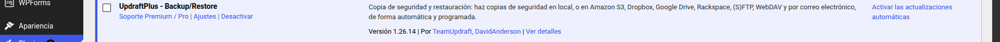

### 13.2 Copia de seguridad completa en Google Drive

1. En **Ajustes → Copias de seguridad de UpdraftPlus → Ajustes** se eligió **Google Drive** como almacenamiento remoto.
2. Se autorizó el acceso con la cuenta de Google.
3. En la pestaña **Copias de seguridad/restauración** se pulsó **Hacer ahora una copia de seguridad**, con base de datos y archivos y enviando la copia al almacenamiento remoto.

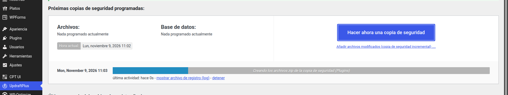

Al terminar, la copia aparece en **Copias de seguridad existentes** con el icono de Google Drive, lo que indica que se ha subido a la nube:

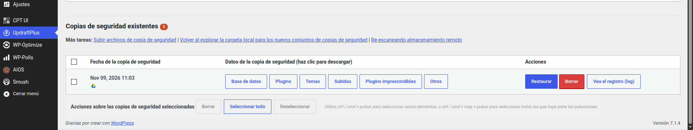

En Google Drive, UpdraftPlus crea la carpeta **Mi unidad → UpdraftPlus** con los archivos de la copia:

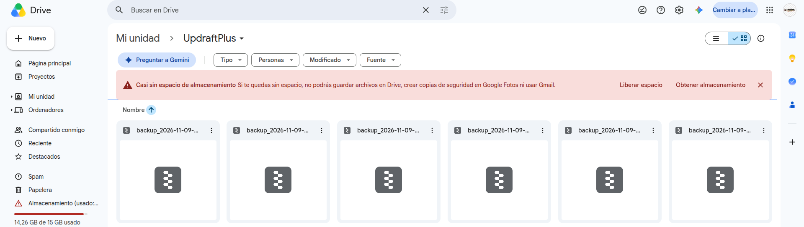

### 13.3 Descarga de los archivos de la copia

Desde **Copias de seguridad existentes** se pulsó cada parte de la copia y luego **Descargar a tu equipo**:

| Parte | Archivo | Tamaño |
|---|---|---|
| Base de datos | `backup_2026-11-09-1103_FFood_5e2a688aed33-db.gz` | 1,06 MB |
| Plugins | `...-plugins.zip` | 122,62 MB |
| Temas | `...-themes.zip` | 14,13 MB |
| Subidas (medios) | `...-uploads.zip` | 55,00 MB |
| Plugins imprescindibles | `...-mu-plugins.zip` | 4,72 KB |
| Otros | `...-others.zip` | 3,07 MB |

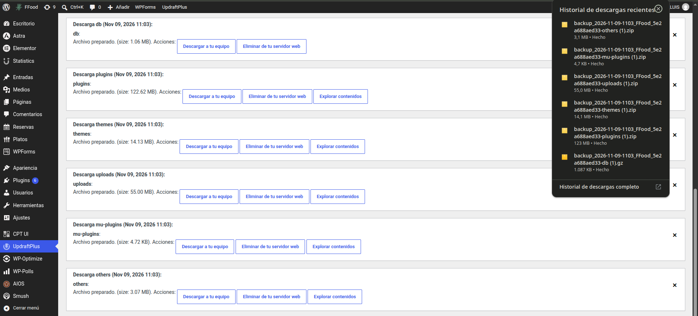

### 13.4 Restauración en el WordPress de Windows (práctica 2.1)

En la instalación de WordPress de Windows de la práctica 2.1 (`http://localhost/ffood/`) se instaló y activó **UpdraftPlus** igual que en el apartado 13.1. Después:

1. En **Ajustes → Copias de seguridad de UpdraftPlus → Copia de seguridad / Restaurar** se pulsó **Subir archivos de copia de seguridad** y se subieron los 6 archivos descargados en el apartado 13.3.
2. UpdraftPlus reconoció la copia del **9 de noviembre de 2026, 11:03** con todas sus partes: base de datos, plugins, temas, subidas, plugins imprescindibles y otros.
3. Se pulsó **Restaurar**, se marcaron todos los componentes y se completó el asistente.

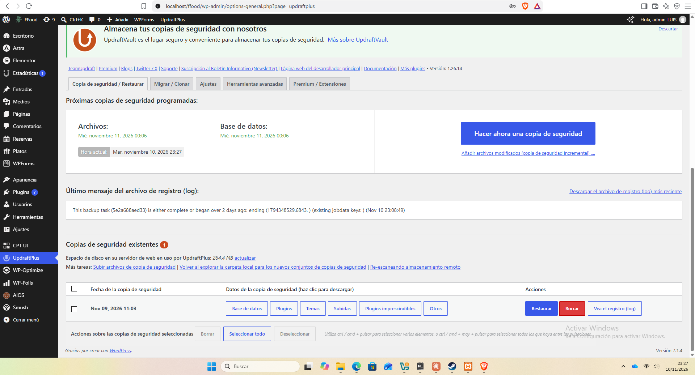

Tras la restauración, el WordPress de Windows tiene el mismo contenido que el original:

- El menú lateral incluye Reservas, Platos, WPForms, CPT UI, WP-Polls y Smush.
- El usuario es `admin_LUIS`.
- La portada de FFood se ve completa en `http://localhost/ffood/`.

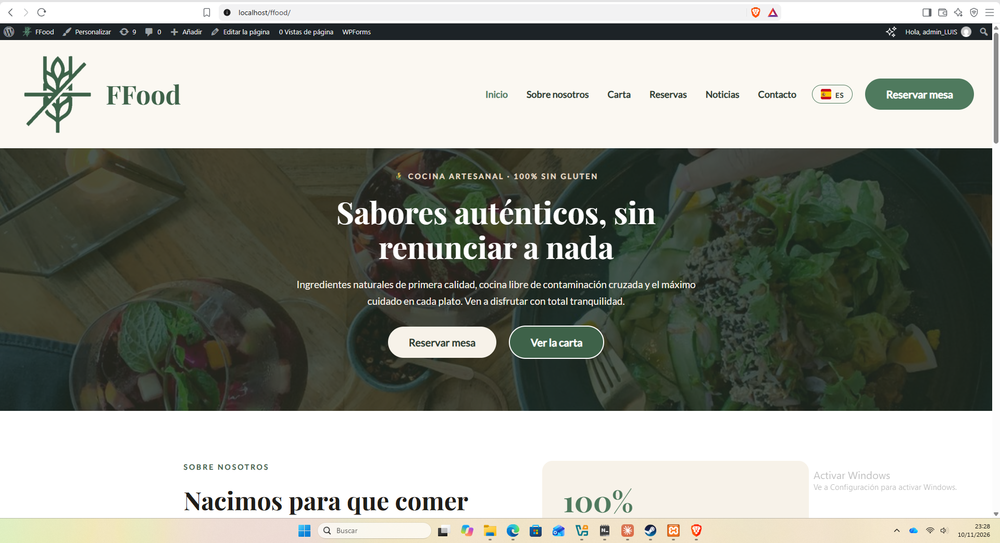
